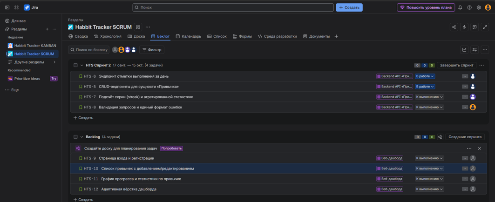
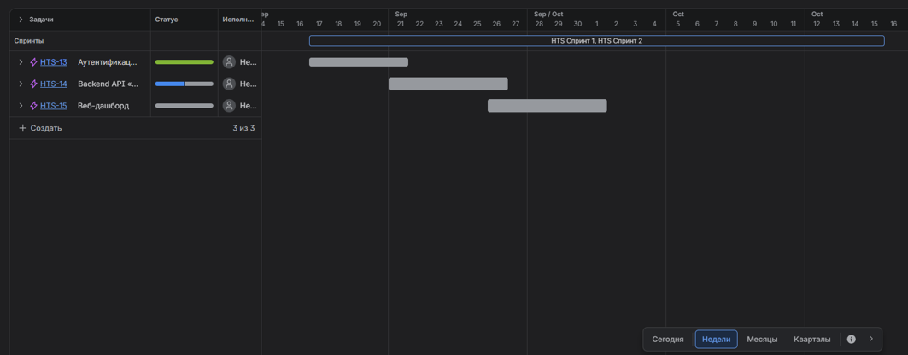
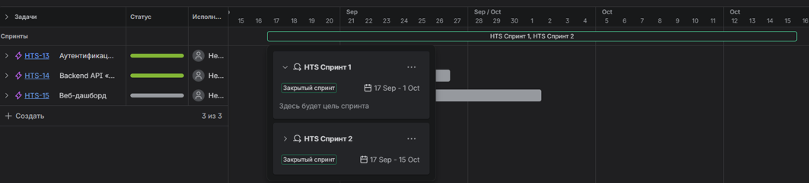
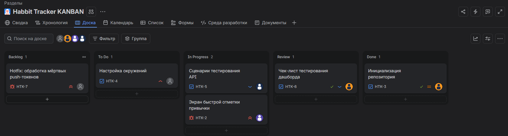
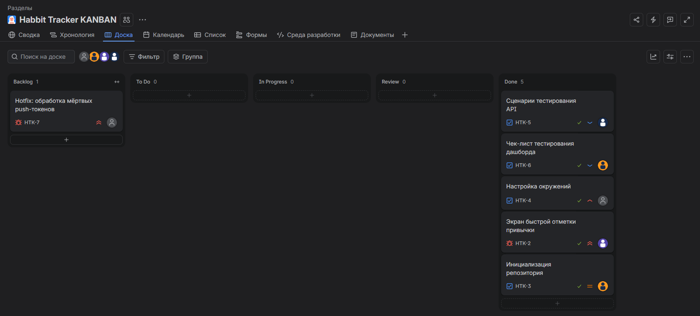

# Практическое занятие №1 — Agile, Scrum, Kanban и управление проектом в Jira

**Цель:** освоить практические инструменты управления программным проектом на доске задач Jira: декомпозицию на эпики и пользовательские истории, планирование и проведение спринта по Scrum, организацию непрерывного потока задач по Kanban.

**Проект:** Habit Tracker — приложение для отслеживания привычек (Backend на Python, Web-дашборд, Mobile на React Native).  
**Роль:** Тимлид (Scrum-мастер / Product Owner).

---

## 1. Настройка проектов в Jira

В рабочем пространстве `habit-tracker` были созданы два проекта:
1. **HTS (Scrum)** — для разработки новых фич с фиксированными итерациями.
2. **HTK (Kanban)** — для потока операционных задач, багфиксов и инфраструктурных улучшений.

В обоих проектах включены:
- **Компоненты** для распределения ролей: `Backend`, `Frontend`, `Mobile`, `QA`, `DevOps`.

---

## 2. Декомпозиция проекта: Эпики и Бэклог

Продукт разбит на 5 эпиков и 20 пользовательских историй. Каждая история оформлена по шаблону *«Как <роль>, я хочу <действие>, чтобы <польза>»* и имеет критерии приёмки.

| № | Эпик | User Story | Роль (Компонент) | SP |
|---|---|---|---|---|
| 1 | E1. Аутентификация и профиль | Регистрация по email/паролю | Backend | 3 |
| 2 | E1. Аутентификация и профиль | Вход в систему (JWT-токен) | Backend | 3 |
| 3 | E1. Аутентификация и профиль | Просмотр и редактирование профиля | Frontend | 2 |
| 4 | E2. Backend API «Привычки» | CRUD-эндпоинты для сущности «Привычка» | Backend | 5 |
| 5 | E2. Backend API «Привычки» | Подсчёт серии (streak) и статистики | Backend | 5 |
| 6 | E3. Веб-дашборд | Список привычек с добавлением/редактированием | Frontend | 5 |
| 7 | E3. Веб-дашборд | График прогресса и статистики по привычке | Frontend | 5 |
| 8 | E4. Мобильное приложение | Экран быстрой отметки привычки | Mobile | 3 |
| 9 | E4. Мобильное приложение | Push-напоминания о привычках | Mobile | 5 |
| 10| E5. Инфраструктура и качество | Инициализация репозитория и структуры | DevOps | 2 |
| 11| E5. Инфраструктура и качество | Набор тестовых сценариев для API | QA | 3 |
| 12| E5. Инфраструктура и качество | Hotfix: обработка мёртвых push-токенов | Mobile | 2 |

*(Полный бэклог из 20 задач загружен в Jira и распределён по проектам HTS и HTK).*

---

## 3. Цикл 1: Scrum (Проект HTS)

### Планирование Спринта 1
- **Sprint Goal:** «Реализовать регистрацию/вход и базовый CRUD привычек, вывести список привычек в вебе».
- **Ёмкость (Velocity):** 18 Story Points.
- В спринт взяты задачи с суммарной оценкой 18 SP, назначенные на соответствующие компоненты.

### Ход спринта и блокеры
В процессе работы задачи перемещались по колонкам: `To Do` → `In Progress` → `Review` → `Done`.  
Был зафиксирован **блокер**: задача HTS-8 (Валидация запросов) получила флаг `blocked` из-за необходимости согласования формата ошибок с Frontend-разработчиком. Решено проведением синхронизации и обновлением критериев приёмки.

### Завершение спринта и Ретроспектива
Спринт завершён (`Complete Sprint`). Краткое ретро:
1. **Хорошо:** Чёткое распределение задач по компонентам ускорило работу.
2. **Не получилось:** Не учли время на код-ревью, из-за чего 2 задачи зависли в `Review`.
3. **Изменим:** В следующем спринте заложим явный буфер на ревью и установим WIP-лимит для колонки `Review`.

---

## 4. Цикл 2: Kanban (Проект HTK)

### Настройка потока
- Столбцы: `Backlog` → `To Do` → `In Progress` → `Review` → `Done`.
- **WIP-лимиты:** `In Progress` ≤ 2, `Review` ≤ 2 (для борьбы с многозадачностью).

### Непрерывный поток и внеплановая задача
Через доску было успешно проведено 5 задач до статуса `Done` с соблюдением лимитов.  
В середине цикла в бэклог была добавлена **внеплановая задача №20** (Hotfix: обработка мёртвых push-токенов). Она была взята в работу вне очереди, что наглядно продемонстрировало ключевое отличие Kanban от Scrum: возможность гибко реагировать на срочные изменения без ожидания следующей итерации.

---

## 5. Сравнительный анализ

| Вопрос | Мой ответ на основе практики |
|---|---|
| **Что было проще спланировать — спринт или поток?** | Поток (Kanban). Не нужно гадать с velocity и объёмом спринта, задачи просто берутся сверху по мере освобождения ресурсов. |
| **Где сложнее было среагировать на внеплановую задачу?** | В Scrum. Бэклог спринта зафиксирован, и добавление задачи требует перепланирования или вытеснения другой задачи, что ломает Sprint Goal. В Kanban это делается естественно. |
| **Какую методологию вы выбрали бы для всего проекта Habit Tracker целиком и почему?** | **Гибридный подход (Scrumban).** Разработку новых фич (Backend, Frontend, Mobile) вести по Scrum для предсказуемости релизов. А задачи DevOps, QA и срочные багфиксы — по Kanban, чтобы не накапливать технический долг и быстро реагировать на инциденты. |

---

## 6. Вывод

В ходе выполнения работы я:
1. Настроил два проекта в Jira (Scrum и Kanban) с компонентами.
2. Провёл декомпозицию продукта Habit Tracker на 5 эпиков и 20 пользовательских историй с критериями приёмки.
3. Успешно спланировал и провёл Scrum-спринт, включая обработку блокера и ретроспективу.
4. Настроил Kanban-доску с WIP-лимитами и отработал сценарий с внеплановой задачей.
5. Сформировал обоснованное представление о том, когда применять каждую из методологий в реальном проекте.
