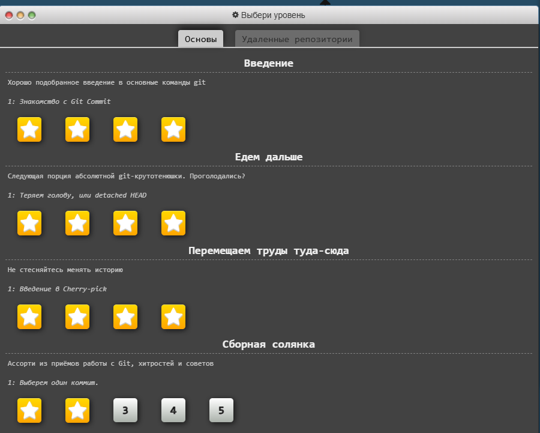

# Практическое занятие №2 — Модель данных Git, ветвление и слияние (Теория + Тренажёр)

**Цель:** разобраться в базовой модели данных Git (объекты blob, tree, commit), понять разницу между merge и rebase, а также изучить механизм возникновения и разрешения конфликтов слияния до начала практической работы в консоли.

---

## 1. Ход работы: интерактивный тренажёр

Для закрепления теоретического материала был пройден интерактивный тренажёр по Git (Learn Git Branching / аналог). 

Были успешно выполнены задания по темам:
- Введение в коммиты и ветвление (`git commit`, `git branch`, `git switch`).
- Слияние веток (`git merge`).
- Перенос коммитов (`git rebase`).

---

## 2. Ответы на контрольные вопросы

1. **Почему в Git создание новой ветки — мгновенная операция, а не копирование файлов?**  
   Потому что ветка в Git — это не копия файлов, а лёгкий текстовый файл размером в несколько байт, который хранит только SHA-1 хэш одного коммита (своего «кончика»). Git не копирует данные, а просто создаёт новый указатель.

2. **Что из объектов Git (blob/tree/commit) хранит сообщение коммита и ссылку на родителя?**  
   Объект **commit**. Он содержит ссылку на корневой `tree` проекта, метаданные (автор, дата, сообщение) и ссылку на один или несколько коммитов-родителей.

3. **В каком случае Git выполнит fast-forward merge, а в каком создаст merge-коммит?**  
   Fast-forward выполняется, если ветка `main` не получила новых коммитов с момента ответвления feature-ветки (Git просто сдвигает указатель `main` вперёд). Merge-коммит создаётся (three-way merge), если в `main` уже были новые коммиты, и Git нужно объединить две расходящиеся линии истории, создав новый коммит с двумя родителями.

4. **Почему у коммита после rebase меняется хэш, даже если содержимое изменений осталось тем же?**  
   Хэш коммита в Git вычисляется на основе его содержимого, метаданных и **хэша родителя**. При rebase коммит «переигрывается» поверх нового основания, то есть у него меняется родитель. Следовательно, меняется и его хэш — технически это уже новый коммит.

5. **Почему нельзя делать rebase уже запушенной публичной ветки?**  
   Потому что rebase переписывает историю (меняет хэши коммитов). Если коллега уже сделал `pull` этой ветки и продолжил работу от старых хэшей, после вашего rebase и force-push его история и ваша станут несовместимыми, что приведёт к хаосу и дублированию коммитов.

6. **Какая команда отменяет merge или rebase, если что-то пошло не так?**  
   `git merge --abort` для отмены слияния и `git rebase --abort` для отмены переноса коммитов. Обе команды возвращают репозиторий в состояние до начала операции.

---

## 3. Вывод

В ходе занятия я изучил внутреннее устройство Git (зоны Working Directory, Staging Area, Repository и объекты blob/tree/commit). Практика в тренажёре позволила визуально закрепить разницу между `merge` (сохраняет историю ветвления) и `rebase` (делает историю линейной, но переписывает хэши), а также понять механизм маркеров конфликтов (`<<<<<<<`, `=======`, `>>>>>>>`). Это создало необходимую теоретическую базу для выполнения Практики №3 в консоли.