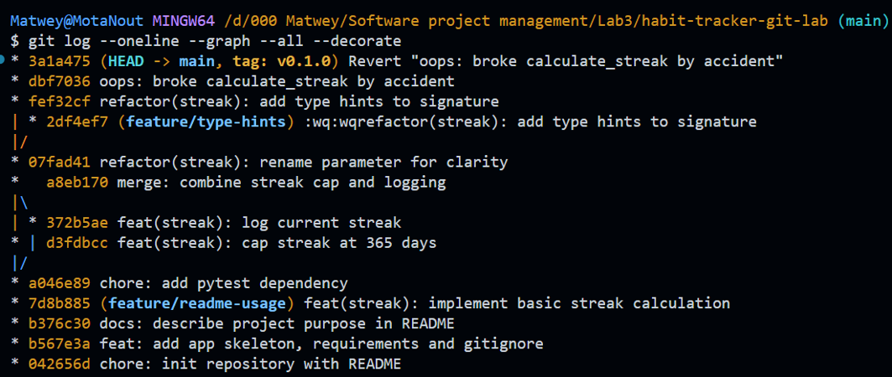

# Практическое занятие №3 — Git в консоли

**Цель:** пройти полный локальный цикл работы с Git — от инициализации репозитория до слияния веток, разрешения конфликтов (merge и rebase), отмены изменений и выбора стратегии ветвления.

**Проект:** Habit Tracker — небольшое консольное приложение для отслеживания привычек.

---

## 1. Структура проекта

```
habit-tracker-git-lab/
├── .git/
├── .gitignore
├── README.md
├── requirements.txt
├── src/
│   └── app.py
├── venv/              (в .gitignore)
├── __pycache__/       (в .gitignore)
└── .env               (в .gitignore)
```


---

## 2. Финальная история коммитов

Команда:
```bash
git log --oneline --graph --all --decorate
```



На графе видно:
- параллельные ветки `feature/streak-basic`, `feature/streak-cap`, `feature/streak-log`, `feature/type-hints`;
- точки слияния (merge-коммиты с двумя родителями);
- тег `v0.1.0` на финальном коммите в `main`.

---

## 3. Задание 8 — конфликт при merge

### Суть конфликта
Две ветки (`feature/streak-cap` и `feature/streak-log`) независимо изменили **одни и те же строки** функции `calculate_streak`:
- `streak-cap` добавил ограничение `min(streak, 365)`;
- `streak-log` добавил `print(f"Текущая серия: {streak}")`.

Git не смог автоматически объединить изменения и остановил слияние с сообщением:
```
CONFLICT (content): Merge conflict in src/app.py
```

### Разрешение
Открыл файл, нашёл маркеры `<<<<<<<`, `=======`, `>>>>>>>`, вручную объединил обе идеи (и ограничение, и логирование) и удалил маркеры:

```python
def calculate_streak(check_ins):
    """Серия (streak) выполнения привычки, максимум 365 дней."""
    streak = 0
    for done in reversed(check_ins):
        if not done:
            break
        streak += 1
    streak = min(streak, 365)
    print(f"Текущая серия: {streak}")
    return streak
```

После этого:
```bash
git add src/app.py
git commit -m "merge: combine streak cap and logging"
```


---

## 4. Задание 9 — конфликт при rebase

### Суть конфликта
Ветка `feature/type-hints` добавляла аннотации типов к сигнатуре функции, а в `main` параллельно было переименовано имя параметра (`check_ins` → `habit_checkins`). При `git rebase main` Git попытался повторно применить коммит с type hints поверх обновлённой `main` и снова остановился на конфликте.

### Отличие от merge
- При **merge** конфликт разрешается один раз и создаётся отдельный merge-коммит.
- При **rebase** конфликт разрешается **в процессе последовательного переноса** коммита, а завершается командой `git rebase --continue` (а не `git commit`). История остаётся линейной, коммит получает новый хэш.

### Разрешение
Объединил обе идеи — новое имя параметра и type hint:
```python
def calculate_streak(habit_checkins: list) -> int:
```
Затем:
```bash
git add src/app.py
git rebase --continue
```

---

## 5. Итоговый файл `src/app.py`

```python
def calculate_streak(habit_checkins: list) -> int:
    """Серия (streak) выполнения привычки, максимум 365 дней."""
    streak = 0
    for done in reversed(habit_checkins):
        if not done:
            break
        streak += 1
    streak = min(streak, 365)
    print(f"Текущая серия: {streak}")
    return streak
```

---

## 6. Вывод

В ходе работы я:
1. Настроил Git и инициализировал репозиторий с корректным `.gitignore`.
2. Освоил разницу между `git diff` и `git diff --staged` (зоны Working Directory / Staging / Repository).
3. На практике увидел разницу между **fast-forward** и **three-way merge**.
4. Самостоятельно воспроизвёл и разрешил конфликты при merge и rebase — понял, что механика одна и та же (маркеры `<<<<<<<` / `=======` / `>>>>>>>`), но команды завершения разные (`git commit` против `git rebase --continue`).
5. Познакомился со страховочной сеткой Git: `git reset`, `git revert` и особенно `git reflog`, который позволяет восстановить «потерянные» коммиты.
6. Сравнил модели ветвления **Git Flow** и **Trunk-Based Development** и поставил тег релиза `v0.1.0`.