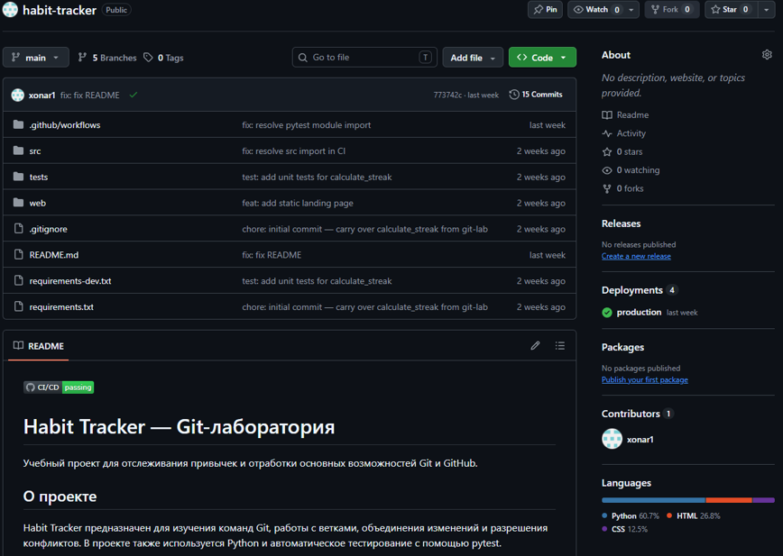
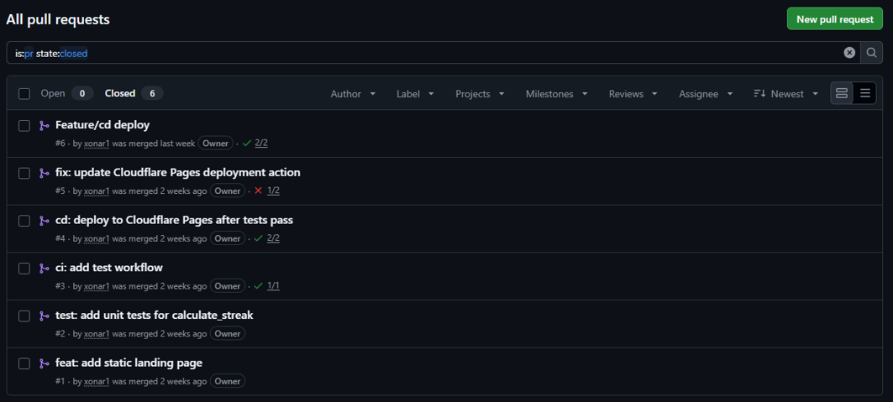
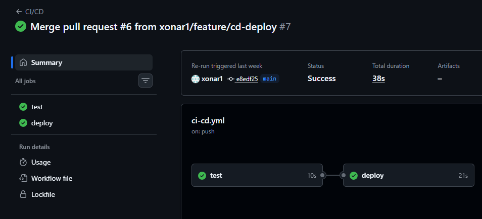
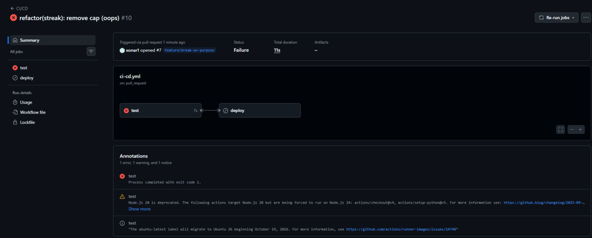
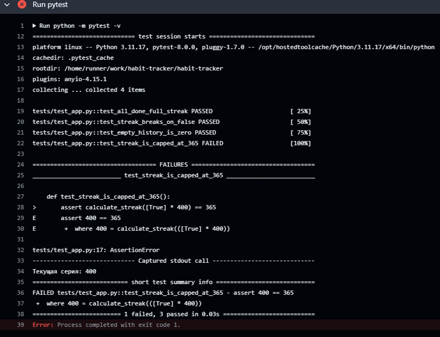
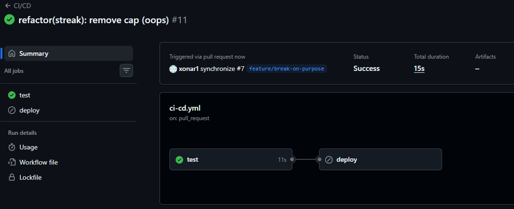
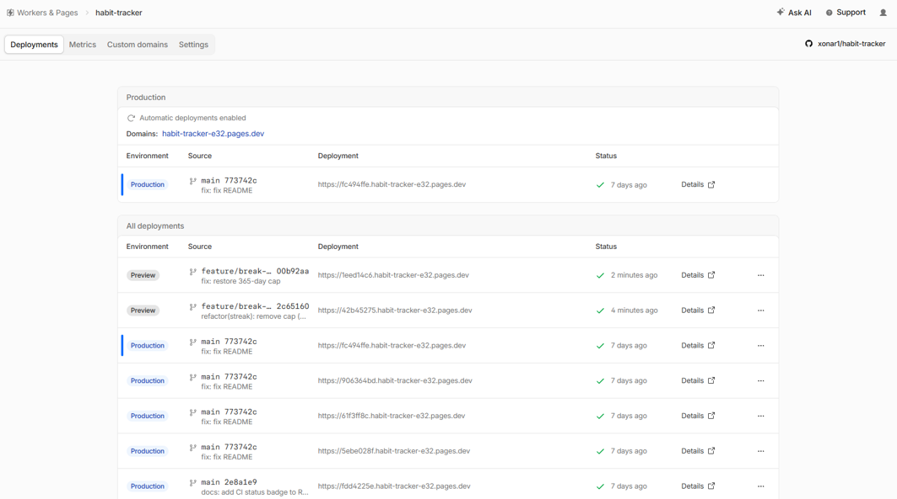

# Практическое занятие №4 — GitHub, GitHub Actions и Cloudflare Pages

**Цель:** превратить локальный проект в настоящий репозиторий на GitHub, настроить автоматическую проверку тестами (CI) и автоматический деплой статического фронтенда на Cloudflare Pages (CD).

**Репозиторий:** <https://github.com/xonar1/habit-tracker>

---

## 1. Репозиторий на GitHub

После переноса кода из лабораторной №3 и первого push в `main`:



### Дерево файлов
```
habit-tracker/
├── .github/
│   └── workflows/
│       └── ci-cd.yml
├── src/
│   └── app.py
├── tests/
│   └── test_app.py
├── web/
│   ├── index.html
│   └── style.css
├── .gitignore
├── README.md
├── requirements.txt
└── requirements-dev.txt
```



---

## 2. Pull Requests

Все изменения вносились через отдельные feature-ветки и Pull Request'ы. Список смерженных PR:

| №  | Название                                   | Статус |
|----|--------------------------------------------|--------|
| #1 | feat: add static landing page              | merged |
| #2 | test: add unit tests for calculate_streak  | merged |
| #3 | ci: add test workflow                      | merged |
| #4 | cd: deploy to Cloudflare Pages after tests pass | merged |
| #5 | fix: update Cloudflare Pages deployment action  | merged |
| #6 | Feature/cd deploy                          | merged |



---

## 3. CI/CD пайплайн

Файл `.github/workflows/ci-cd.yml` содержит два job'а:

```yaml
name: CI/CD

on:
  push:
    branches: [main]
  pull_request:
    branches: [main]

jobs:
  test:
    runs-on: ubuntu-latest
    steps:
      - uses: actions/checkout@v4
      - uses: actions/setup-python@v5
        with:
          python-version: "3.11"
      - run: pip install -r requirements.txt -r requirements-dev.txt
      - run: pytest -v

  deploy:
    needs: test
    if: github.ref == 'refs/heads/main' && github.event_name == 'push'
    runs-on: ubuntu-latest
    steps:
      - uses: actions/checkout@v4
      - name: Deploy to Cloudflare Pages
        uses: cloudflare/pages-action@v1
        with:
          apiToken:    ${{ secrets.CLOUDFLARE_API_TOKEN }}
          accountId:   ${{ secrets.CLOUDFLARE_ACCOUNT_ID }}
          projectName: habit-tracker
          directory:   web
```

Ключевые моменты:
- `needs: test` — деплой запускается **только** после успешного прохождения тестов.
- `if: github.ref == 'refs/heads/main'` — деплоим только push'и в `main`, а не каждый PR.

### Успешный прогон



Оба job'а (`test` и `deploy`) завершились со статусом **Success**.

---

## 4. Проверка защиты пайплайна

Чтобы убедиться, что `needs: test` действительно работает как шлагбаум, я намеренно сломал тест.

### Шаг 1 — ломаем код
В `src/app.py` убрал ограничение в 365 дней:
```python
return streak          # было: return min(streak, 365)
```
Коммит: `refactor(streak): remove cap (oops, тест должен упасть)`.

### Шаг 2 — тест падает, деплой не стартует
Job `test` завершился с ошибкой:
```
FAILED tests/test_app.py::test_streak_is_capped_at_365
>       assert calculate_streak([True] * 400) == 365
E       assert 400 == 365
```
Job `deploy` даже не запустился — `needs: test` его заблокировал.



### Шаг 3 — чиним и проверяем
Вернул `return min(streak, 365)` — тесты снова зелёные, деплой отработал.



---

## 5. Деплой на Cloudflare Pages

Проект `habit-tracker` в Cloudflare Pages. После каждого успешного push в `main` появляется новый Production-деплой:

| Environment | Source      | Commit  | URL                                                    |
|-------------|-------------|---------|--------------------------------------------------------|
| Production  | main        | 773742c | <https://fc494ffe.habit-tracker-e32.pages.dev>         |
| Preview     | feature/... | 00b92aa | <https://1eed14c6.habit-tracker-e32.pages.dev>         |



Сайт открывается по адресу <https://habit-tracker-e32.pages.dev> и показывает актуальную версию `web/index.html`.

---

## 6. Бейдж статуса сборки

В начало `README.md` добавлен бейдж:
```markdown

```
На странице репозитория теперь виден зелёный значок **passing**.

---

## 7. Рефлексия

**В чём разница между CI и CD?**
CI (Continuous Integration) — это автоматическая сборка и прогон тестов на каждый push и Pull Request, чтобы сломанный код не попал в основную ветку незамеченным. CD (Continuous Delivery/Deployment) — это автоматическая доставка уже проверенного кода в рабочее окружение (в нашем случае — на Cloudflare Pages) без ручных шагов.

**Почему `deploy` зависит от `test` через `needs`, а не просто идёт следом?**
Потому что `needs:` — это явная зависимость в графе выполнения GitHub Actions. Если `test` упадёт, job `deploy` не запустится вовсе. Если бы мы просто написали job'ы друг за другом в YAML-файле, они бы по умолчанию выполнялись **параллельно**, и деплой ушёл бы в прод независимо от результата тестов.

**Что произошло бы, если убрать `needs: test`?**
Каждый push в `main` сразу запускал бы деплой, даже если тесты падают. На практике это означает, что сломанный код моментально оказывается у пользователей, а ошибка обнаруживается постфактум. Именно поэтому `needs:` — это обязательный «шлагбаум», а не формальность.

---

## 8. Итог

В результате лабораторной:
- создан публичный репозиторий на GitHub с полной историей изменений через Pull Requests;
- настроен workflow `ci-cd.yml` с job'ами `test` и `deploy`;
- продемонстрирована защита пайплайна: упавший тест блокирует деплой;
- статический фронтенд автоматически публикуется на Cloudflare Pages;
- в `README.md` добавлен бейдж статуса сборки.