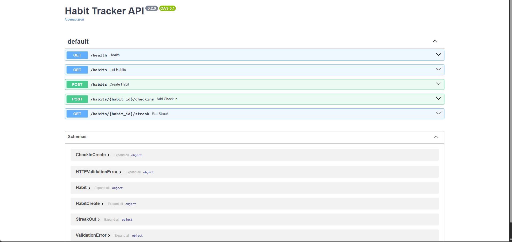
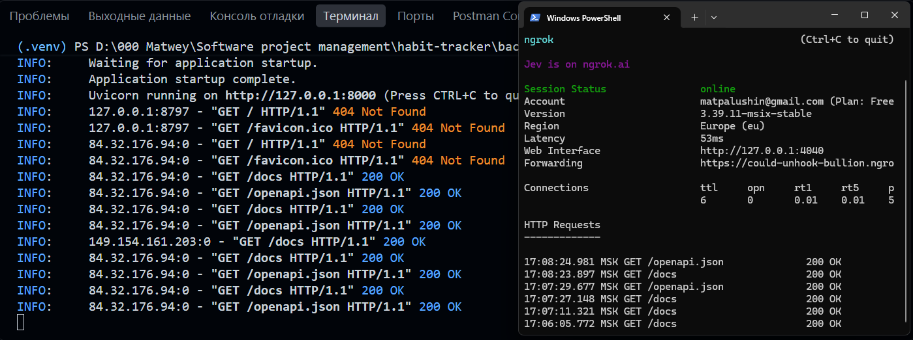
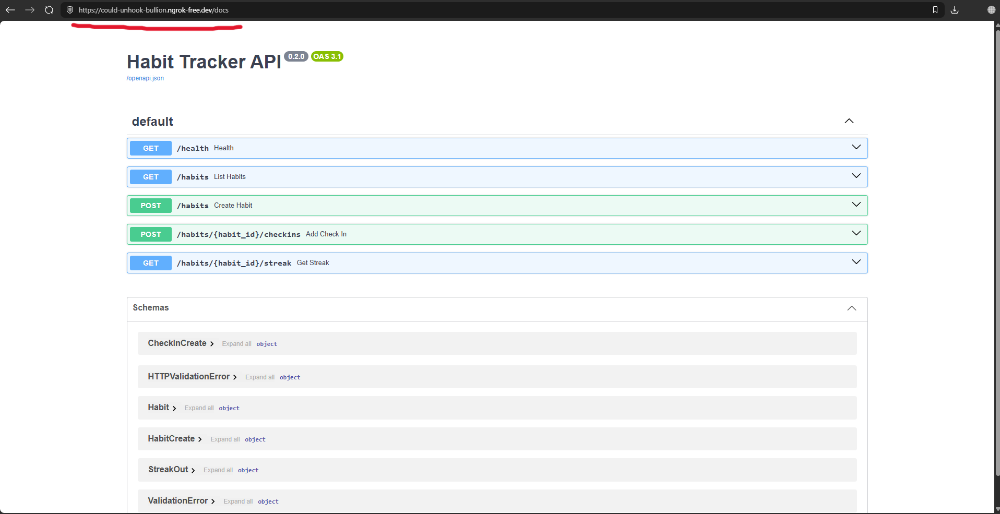
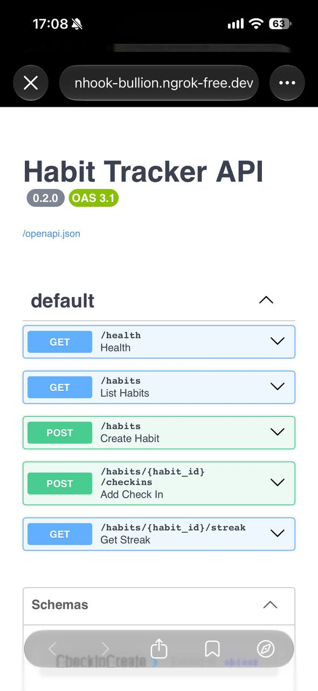
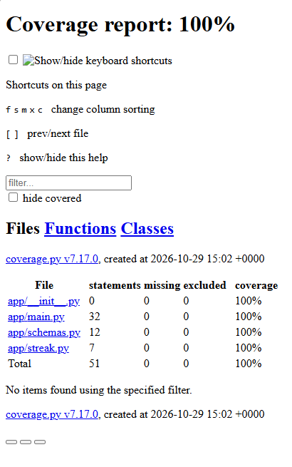
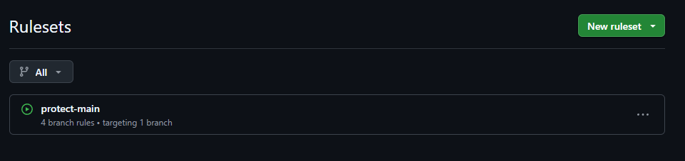
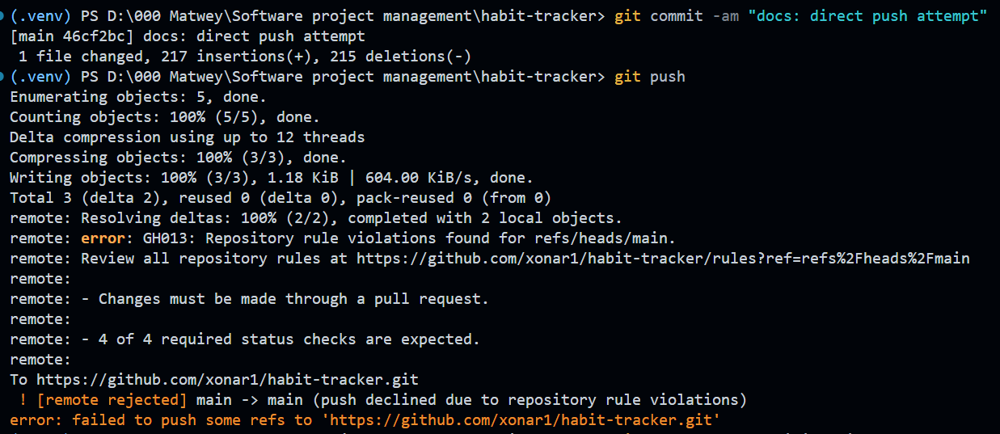
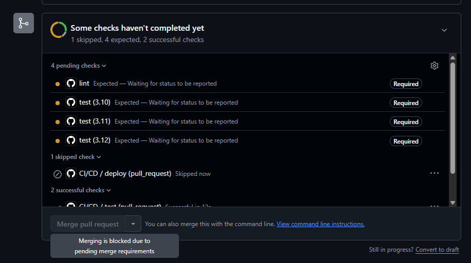
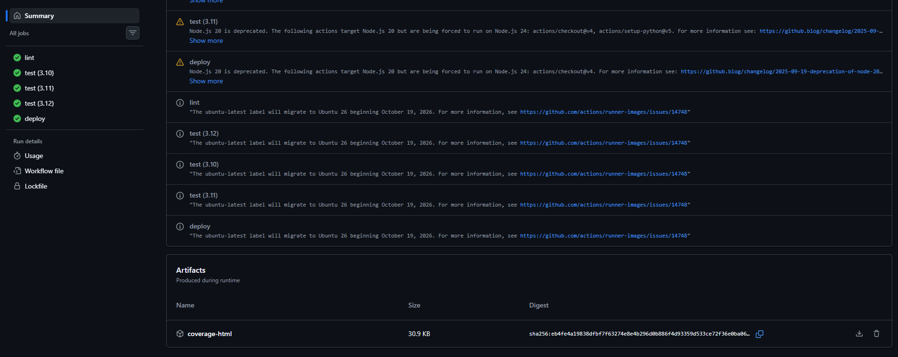

# Практическое занятие №5 — Backend на FastAPI и углублённый CI/CD

**Цель:** превратить функцию `calculate_streak` в настоящий backend на FastAPI, открыть его для всех через Cloudflare Tunnel (ngrok) и вырастить простой CI из практики 4 в полноценный пайплайн: линтер, матрица версий Python, кэш зависимостей, отчёт о покрытии тестами, артефакты, отмена устаревших запусков и защита ветки `main`, которая физически не пускает в неё красный код.

**Репозиторий:** <https://github.com/xonar1/habit-tracker>

---

## 1. Реструктуризация репозитория (Задание 1)

Backend теперь живёт в своей папке рядом с `web/`. Переносим файлы командой `git mv`, чтобы Git сохранил историю каждого файла.

```bash
git switch main && git pull
git switch -c feature/fastapi-backend
mkdir -p backend/app backend/tests
git mv src/app.py backend/app/streak.py
git mv tests/test_app.py backend/tests/test_streak.py
git mv requirements.txt backend/requirements.txt
git mv requirements-dev.txt backend/requirements-dev.txt
touch backend/app/__init__.py
rmdir src tests
```

### Итоговая структура проекта

```
habit-tracker/
├── backend/
│   ├── app/
│   │   ├── __init__.py
│   │   ├── main.py
│   │   ├── schemas.py
│   │   └── streak.py
│   ├── tests/
│   │   ├── test_api.py
│   │   └── test_streak.py
│   ├── pytest.ini
│   ├── requirements.txt
│   └── requirements-dev.txt
├── web/
│   ├── index.html
│   └── style.css
├── .github/
│   └── workflows/
│       └── ci-cd.yml
└── .gitignore
```


---

## 2. Каркас FastAPI и эндпоинты (Задания 2-3)

### Эндпоинты API

| Метод | Путь | Описание |
|-------|------|----------|
| `GET` | `/health` | Проверка работоспособности |
| `POST` | `/habits` | Создать привычку |
| `GET` | `/habits` | Список всех привычек |
| `POST` | `/habits/{id}/checkins` | Отметить выполнение |
| `GET` | `/habits/{id}/streak` | Получить текущую серию |

### Swagger UI

FastAPI автоматически строит интерактивную документацию из кода. Открываем `http://127.0.0.1:8000/docs` и видим готовый Swagger UI.



---

## 3. Публикуем API для всех: ngrok (Задание 5)

Вместо Cloudflare Tunnel использован **ngrok** — причина в том, что исходящие соединения на порты 7844/443 для протоколов QUIC и HTTP2 блокируются на уровне сетевого оборудования моего интернет-провайдера, что делало запуск quick-tunnel невозможным (ошибка UDP/TCP Connectivity FAIL). Ngrok успешно решил задачу проброса локального порта 8000 в интернет.

### Запуск

**Терминал 1** — API:
```bash
cd backend
uvicorn app.main:app --port 8000
```

**Терминал 2** — тоннель:
```bash
ngrok http 8000
```

В выводе ngrok появится ссылка вида `https://xxxx-xx-xx-xx.ngrok-free.app` — это публичный адрес API.



### Проверка доступности

Открываем `/docs` с ПК через ngrok:



Открываем `/docs` с телефона через мобильный интернет (не через Wi-Fi) — убеждаемся, что API действительно виден из интернета:



---

## 4. CI/CD: working-directory (Задание 6)

После рефакторинга старый workflow из практики 4 всё ещё ищет `requirements.txt` и `tests` в корне репозитория, а мы перенесли их в `backend/`. Добавляем `defaults.run.working-directory`:

```yaml
test:
  runs-on: ubuntu-latest
  defaults:
    run:
      working-directory: backend
  steps:
    - uses: actions/checkout@v4
    - uses: actions/setup-python@v5
      with:
        python-version: "3.11"
    - run: pip install -r requirements-dev.txt
    - run: pytest -v
```

---

## 5. Линтер ruff как отдельный параллельный job (Задание 7)

Добавляем job `lint` с линтером `ruff`, который проверяет стиль кода и находит ошибки, невидимые для тестов (неиспользуемые импорты, неопределённые имена).

Для демонстрации независимости job'ов был намеренно добавлен неиспользуемый `import os` в `backend/app/main.py`. После push в PR:
- 🔴 job `lint` — красный (ошибки `I001` и `F401`)
- 🟢 job `test` — зелёный (тесты проходят)
- ⏸️ job `deploy` — не запустился (заблокирован через `needs: [lint, test]`)

Это показывает, что **job'ы независимы и идут параллельно**. Ошибка автоматически исправлена командой `ruff check --fix .`, после чего все проверки стали зелёными.

---

## 6. Матрица версий Python и кэш pip (Задание 8)

Матрица запускает один и тот же job сразу на нескольких версиях Python параллельно:

```yaml
test:
  runs-on: ubuntu-latest
  strategy:
    fail-fast: false
    matrix:
      python-version: ["3.10", "3.11", "3.12"]
  defaults:
    run:
      working-directory: backend
  steps:
    - uses: actions/checkout@v4
    - uses: actions/setup-python@v5
      with:
        python-version: ${{ matrix.python-version }}
        cache: pip
        cache-dependency-path: |
          backend/requirements.txt
          backend/requirements-dev.txt
    - run: pip install -r requirements-dev.txt
    - run: pytest -v
```

- `fail-fast: false` — если одна версия упала, остальные всё равно дойдут до конца
- `cache: pip` — зависимости скачиваются один раз и переиспользуются

В списке проверок появляются три job'а: `test (3.10)`, `test (3.11)`, `test (3.12)`.

---

## 7. Покрытие кода и артефакт с отчётом (Задание 9)

Запускаем тесты с замером покрытия, требуем не менее 80% и сохраняем HTML-отчёт:

```yaml
- run: pytest -v --cov=app --cov-report=term-missing --cov-report=html --cov-fail-under=80
- uses: actions/upload-artifact@v4
  if: matrix.python-version == '3.12'
  with:
    name: coverage-html
    path: backend/htmlcov
```

После завершения запуска скачиваем артефакт `coverage-html`, распаковываем и открываем `index.html`. Результат — **100% покрытие**:

| File | statements | missing | coverage |
|------|------------|---------|----------|
| app/__init__.py | 0 | 0 | 100% |
| app/main.py | 32 | 0 | 100% |
| app/schemas.py | 12 | 0 | 100% |
| app/streak.py | 7 | 0 | 100% |
| **Total** | **51** | **0** | **100%** |



---

## 8. concurrency и фильтр paths (Задание 10)

Две настройки на уровне всего workflow:

```yaml
on:
  push:
    branches: [main]
    paths:
      - "backend/**"
      - "web/**"
      - ".github/workflows/ci-cd.yml"
  pull_request:
    branches: [main]

concurrency:
  group: ci-${{ github.ref }}
  cancel-in-progress: ${{ github.ref != 'refs/heads/main' }}
```

- `concurrency` — отменяет устаревшие запуски при быстрых последовательных коммитах
- `paths` — запускает pipeline только при изменениях в нужных папках

⚠️ **Важно:** `paths` указан только для `push`, а для `pull_request` — нет. Причина: если у workflow есть фильтр `paths` и он не запустился, обязательная проверка из ruleset зависнет в ожидании и заблокирует PR навсегда.

---

## 9. Защита main: обязательные проверки (Задание 11)

Настроен ruleset `protect-main` (Settings → Rules → Rulesets) с тремя правилами:
- ✅ Require a pull request before merging (0 approvals)
- ✅ Require status checks to pass (lint, test 3.10/3.11/3.12)
- ✅ Block force pushes



### Проверка защиты

Прямой push в `main` отклоняется с ошибкой:

```
remote: error: GH006: Protected branch update failed for refs/heads/main.
remote: - Changes must be made through a pull request.
```



### Блокировка Merge при красной проверке

Создан демонстрационный PR с намеренно сломанным lint (лишний `import os`) — кнопка **Merge pull request** заблокирована до прохождения всех обязательных проверок:



После исправления стиля через `ruff check --fix .` и повторного push все проверки стали зелёными, кнопка Merge разблокировалась.

---

## 10. Успешный запуск workflow

После выполнения всех заданий в Actions видны четыре параллельные проверки и артефакт `coverage-html`:



---


## 11. Рефлексия

### Вопрос 1: Чем матрица отличается от нескольких одинаковых job'ов, написанных вручную, и какую проблему она решает?

Матрица (`strategy.matrix`) позволяет задать список значений (например, версий Python) в одном месте, избегая дублирования YAML-кода. Если нужно добавить Python 3.13, достаточно дописать одну строку в массив, а не копировать весь блок job'а. Это решает проблему поддержки: изменения в логике тестов нужно вносить только один раз, а не в трёх местах.

### Вопрос 2: Почему `paths` на `pull_request` мог бы заблокировать слияние при включённых обязательных проверках?

Если у workflow есть фильтр `paths` и он не запустился (потому что изменился только README.md), обязательная проверка из ruleset зависнет в состоянии "Expected — Waiting for status to be reported" и заблокирует PR навсегда. GitHub будет бесконечно ждать завершения проверки, которая никогда не начнётся. Поэтому `paths` указываем только для `push`, а для `pull_request` проверяем всегда.

### Вопрос 3: Почему Cloudflare Tunnel подходит для демонстрации API, но не подходит как цель деплоя из GitHub Actions?

Туннель пробрасывает локальный порт наружу, пока процесс `cloudflared` запущен на вашей машине. Runner GitHub Actions — это временная виртуальная машина, которая уничтожается сразу после завершения job'а. Туннель просто не сможет работать постоянно в среде CI. Туннель хорош там, где процесс живёт долго: на ноутбуке или постоянно работающем сервере.

---

## 13. Вывод

В ходе выполнения работы:
1. Реструктурировал репозиторий через `git mv`, сохранив историю файлов
2. Создал backend на FastAPI с эндпоинтами для привычек и подсчёта streak
3. Опубликовал API через ngrok и проверил доступность с телефона
4. Настроил CI/CD с working-directory, линтером ruff, матрицей Python, кэшем pip
5. Добавил замер покрытия кода (100%) и артефакт с HTML-отчётом
6. Настроил concurrency и фильтр paths
7. Защитил ветку `main` через ruleset — прямой push отклоняется, merge заблокирован при красной проверке
8. Понял разницу между CI и CD, важностью `needs:` и ограничениями туннелей

Этот пайплайн теперь физически не пускает красный код в `main`.